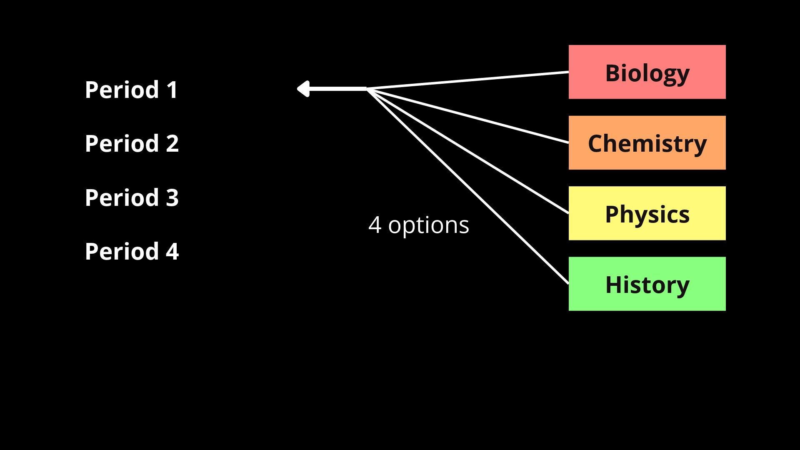
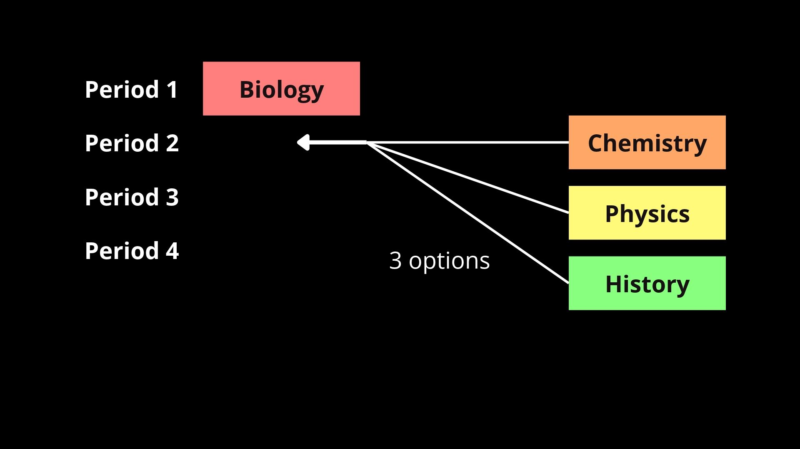
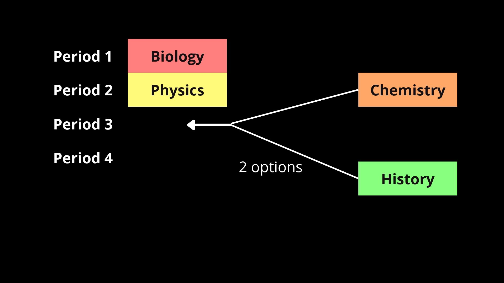
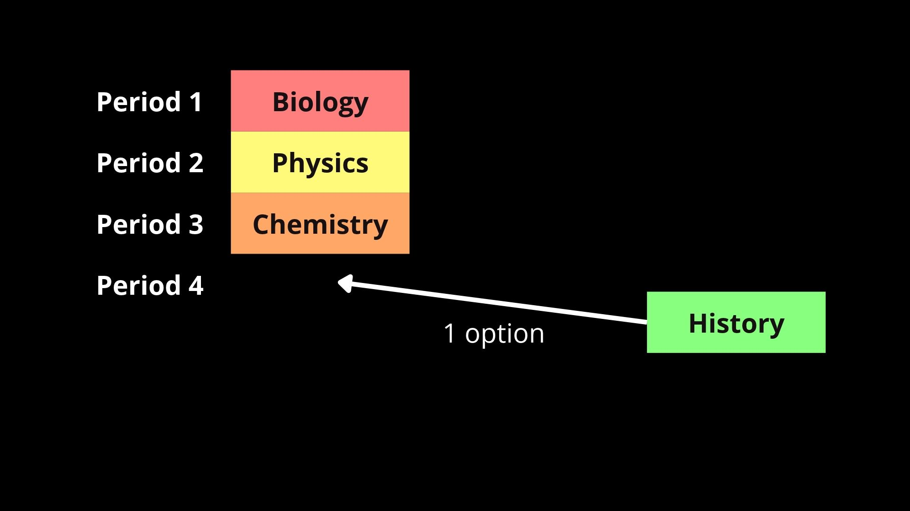
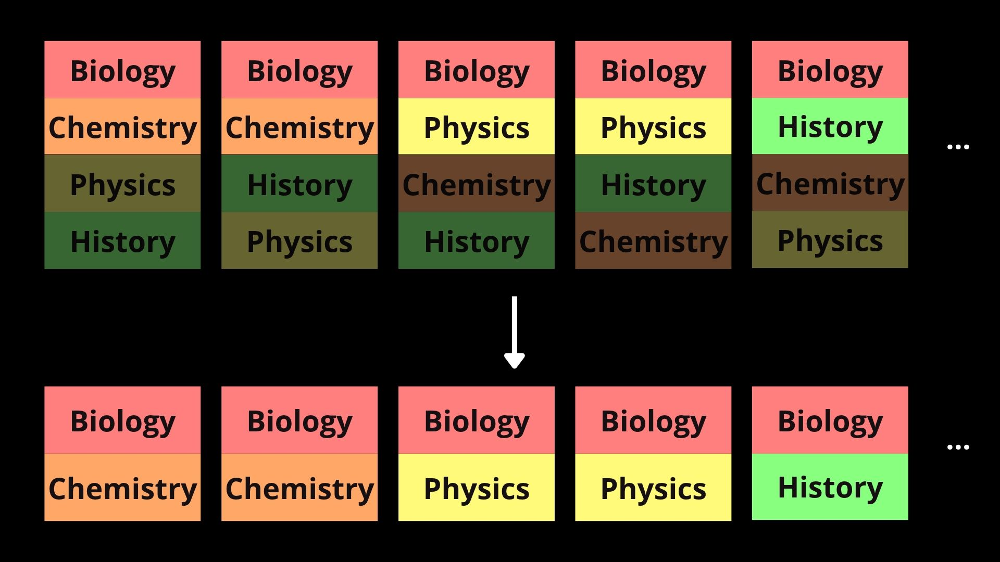
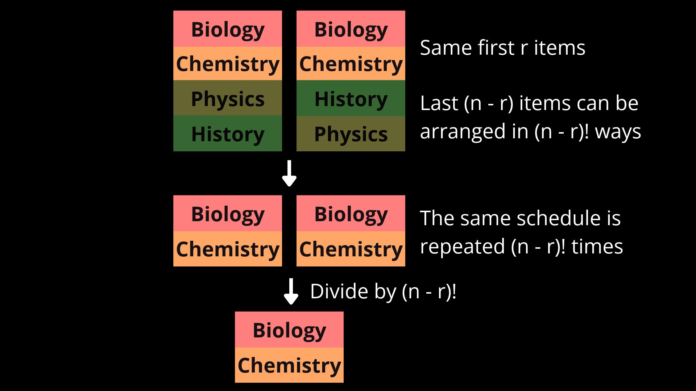
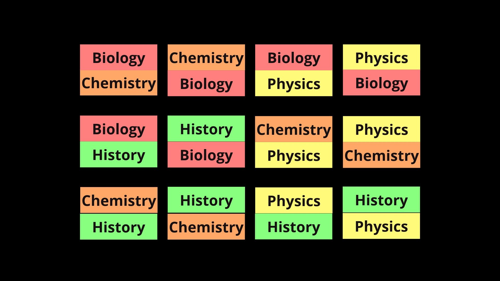
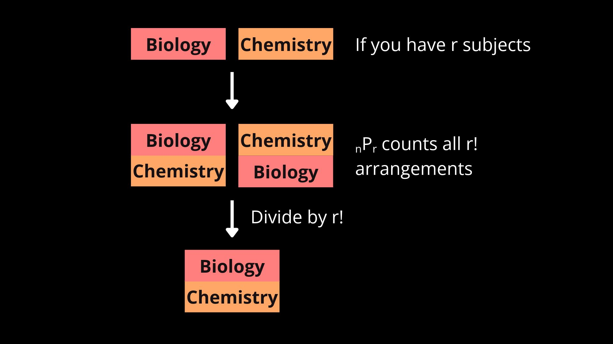

# Factorials, Permutations, and Combinations

[Back to Home](../../../README.md)

## Permutation of $n$ objects

You have been hired as an administrator at a school, and you're tasked with scheduling the lessons. For simplicity, each day is broken up into 4 periods, and you just have to schedule 4 subjects—biology, chemistry, physics, and history—for one day.

There are many ways to arrange this schedule, but how many are there exactly?

Let's call the total number of objects $n$. In this case, it is 4.

$$\text{Total options} = \underbrace{4}_\text{period 1} $$

Start with the first period. There are 4 possible subjects you can assign to it, so let's say you choose biology.

$$\text{Total options} = \underbrace{4}_\text{period 1} \times \underbrace{3}_\text{period 2}$$

Now, there are 3 subjects left you can assign to the second period. Therefore, looking at only the first two periods, there are $4 \times 3$ options.

You can picture this like a diverging path. At first, the path diverges into 4 (your choice for the first subject). And whichever one you follow will later diverge again into 3 (choosing the second subject). This is why multiplication is used.

$$\text{Total options} = \underbrace{4}_\text{period 1} \times \underbrace{3}_\text{period 2} \times \underbrace{2}_\text{period 3}$$

There will be 2 options left for the third period. Each path from before branches into 2, making the total number $4 \times 3 \times 2$.

$$\text{Total options} = \underbrace{4}_\text{period 1} \times \underbrace{3}_\text{period 2} \times \underbrace{2}_\text{period 3} \times \underbrace{1}_\text{period 4}$$

Finally, there is one option left to assign to the last period, which means we multiply by 1 at the end.

Try this same scenario but with different numbers. For example, assigning 6 subjects to 6 periods ($n = 6$). 

| Period | Options |
| :---: | :---: |
| 1 | 6 |
| 2 | 5 |
| 3 | 4 |
| 4 | 3 |
| 5 | 2 |
| 6 | 1 |

Notice the pattern here. When filling the first slot, there were $n$ options. Then, for each subsequent slot, the number of options lowers by 1. This repeats until the last slot, which always has 1 option. The product of all of the numbers is the number of possible schedules.

The example we just analyzed involves **permutation**, the act of arranging objects in a specific order. And the operation we discovered for calculating the number of permutations has a name, the **factorial**. It is written with an exclamation mark.

$$n! = n \times (n-1) \times (n-2) \times \cdots \times 3 \times 2 \times 1$$

In the first example, the number of ways to make a schedule containing 4 periods using 4 subjects is $4! = 4 \times 3 \times 2 \times 1 = 24$.

The factorial can be used in many different cases. Deciding the presentation order of students, arranging books on a shelf, shuffling a deck of cards, etc. The last example is quite infamous, because the number of ways to arrange a deck of cards ($52!$) is an unimaginably large number ([watch this YouTube short](https://youtube.com/shorts/L0nmxIQWefA?si=hoB8cJr2hfmuJrbY)).

## Permutation of $n$ objects out of $r$ total objects

The student council is holding an election. Who will win, Cole or Leo?? Who cares, because the event is going to take up the last 2 periods of the day, leaving 2 left for regular classes. With this extra constraint, how many permutations of the schedule are left?

$n$ is equal to 4, because there are still 4 subjects to choose from. However, we introduce a new variable, $r$, which represents how many of those subjects we can take. In this case, $r = 2$.

Start with $n!$ schedules containing $n$ periods (what we did before). Then, chop off the last $(n - r)$ periods from every possible schedule, leaving $r$ periods left in each.

We still have $n!$ schedules. But, you can see that this process left duplicate schedules, which shouldn't count as unique. Think about why this happens. 

When a schedule has the same first $r$ subjects, but the last $(n - r)$ are in a different order, it results in a duplicate. And the last $(n - r)$ subjects can be ordered in $(n - r)!$ different ways. 

So, we must divide the amount of schedules by $(n - r)!$ to avoid counting the duplicates. 

And that is how to find the number of ways to permutate $r$ objects out of $n$ total objects. This operation can be notated in a few different ways, as seen below.

$$_nP_r = \ ^nP_r = P(n, r) = \frac{n!}{(n-r)!}$$

$$\frac{\overbrace{n!}^\text{initial number of permutations}}{\underbrace{(n-r)!}_\text{remove exact duplicates}}$$

Using this formula, the example can be solved like so.

$$\text{Total ways} = \ _4P_2 = \frac{4!}{(4 - 2)!} = \frac{24}{2} = 12$$

## Combinations

Permutation is useful when order *does* matter, like when making a schedule. But for students deciding which books to bring for school, they simply need to know what subjects there will be, *not in what order*. When order doesn't matter, combinations are needed.

Essentially, it is asking the question: "How many ways are there to choose $r$ objects out of $n$ total?" Using the example from before, $n = 4$ and $r = 2$.

There are $_nP_r$ possible permutations, as we know from the previous section. But again, we must get rid of duplicates. As a student packing your backpack, biology-chemistry requires the exact same books as chemistry-biology, so they should be considered the same.

Accounting for this is actually quite simple. Given any $r$ subjects, there are $r!$ ways to arrange them. Since $_nP_r$ counted all of them, just divide the total amount by $r!$ to correct it.

In conclusion, the formula for the number of combinations is just the $_nP_r$ formula divided by $r!$. Again, this can be written in a few different ways, most commonly as $_nC_r$ or $\binom{n}{r}$, read as $n$ choose $r$.

$$_nC_r = \ ^nC_r = C(n, r) = \binom{n}{r} = \frac{n!}{r!(n-r)!}$$

$$\frac{\overbrace{n!}^\text{initial number of permutations}}{\underbrace{(n-r)!}_\text{remove exact duplicates}\underbrace{r!}_\text{stop caring about order}}$$

We can calculate 4 choose 2 to solve the example.

$$\text{Total ways} = \ _4C_2 = \frac{4!}{2!(4-2)!} = \frac{24}{2 \times 2} = 6$$

## Additional tips and tricks

$$_nC_r = \ _nC_{(n-r)}$$

You can prove this pretty simply using the formula, but intuitively, it also makes sense. If you have 10 objects, choosing 8 out of them is the same as choosing 2 to leave out of your choice.

---

$$_nC_0 = \ _nC_n = 1$$

If you think about it, if you have 10 objects, there is only one way to choose nothing, and also only one way to choose all 10 objects.

---

$$_nC_1 = \ _nC_{(n-1)} = n$$

For instance, the number of ways to choose 1 object out of 10 objects is just 10. Choosing 9 objects is the same as choosing 1 to leave out.

---

$$_nC_r = \frac{\overbrace{n(n - 1)(n - 2) \cdots (n - r + 1)}^\text{first $r$ numbers of $n!$}}{r!}$$

This is always a useful shortcut when calculating $_nC_r$. It makes it possible to mentally calculate some examples, like when $r = 2$. The proof is written below:

> $$\begin{align*}
_nC_r &= \frac{n!}{r!(n - r)!} \\
&= \frac{n(n - 1) \cdots (n - r + 1)(n - r)\cdots(1)}{r!(n - r)!} \\
&= \frac{n(n - 1) \cdots (n - r + 1)\cancel{(n - r)!}}{r!\cancel{(n - r)!}} \\
&= \frac{n(n - 1) \cdots (n - r + 1)}{r!}
\end{align*}$$

Example:

> $$_{10}C_2 = \frac{10(9)}{2!} = \frac{\overset{5}{\cancel{10}}(9)}{\cancel{2}} = 45$$